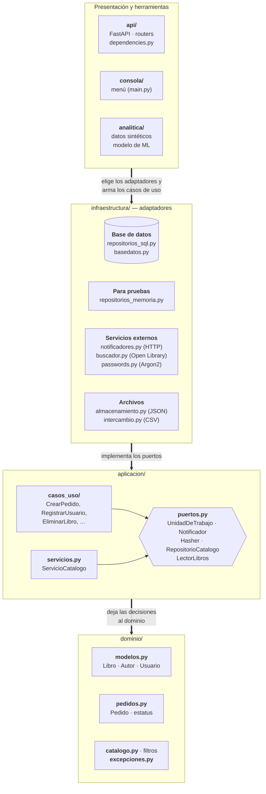

# Proyecto: Librería

Sistema para administrar la librería **Libros Libres**: catálogo de libros, clientes, pedidos y reportes de ventas. Se usa de dos formas:

- **Consola**: un menú para consultar, filtrar, agregar e importar libros del catálogo (archivo JSON), con autocompletado desde Open Library.
- **API web** (FastAPI): libros, usuarios, pedidos y reportes sobre una base de datos SQLite, con inicio de sesión (JWT) y roles.

Incluye además un modelo de *machine learning* que estima qué libros serán *best sellers*.

Proyecto Integrador del curso **Axity Python**.

- Autor: [Javier González](https://github.com/javier-gonzalezj)
- Datos de libros y portadas: [Open Library](https://openlibrary.org), un proyecto de Internet Archive.

## Características

- **Catálogo por consola**: paginado, con filtros (autor, género, disponibilidad, precio, año) que se pueden exportar a JSON, e importación desde CSV que reporta las filas con errores sin detener la carga.
- **Autocompletado por ISBN** con Open Library y **descarga de portadas** concurrente (`asyncio`), sin dejar archivos a medias si se corta la conexión.
- **API REST** con documentación interactiva en `/docs`, autenticación JWT, roles `cliente` y `admin`, y contraseñas guardadas como hash Argon2.
- **Base de datos** con SQLAlchemy y **migraciones** versionadas con Alembic.
- **Pedidos seguros**: crear un pedido es una sola transacción (si falta stock, no se guarda nada) y cancelarlo regresa los libros al inventario.
- **Arquitectura por capas** (dominio, aplicación, infraestructura, presentación), vigilada por una prueba automática.
- **Predicción de best sellers** con scikit-learn, entrenada con ventas sintéticas.
- **393 pruebas** (unitarias, de contrato, de integración y de la API), **Docker multistage**, **integración continua** con GitHub Actions y **auditoría de dependencias** con `pip-audit` (en cada push y cada semana) y Dependabot.

## Requisitos

- Python 3.13 o superior (serie 3.x)
- [Poetry](https://python-poetry.org) 2.3 o superior: el `poetry.lock` se generó con la 2.5.1, y las versiones 2.2 y anteriores lo rechazan
- Opcional: conexión a internet (autocompletado por ISBN y portadas) y [Docker](https://www.docker.com)

## Instalación

```bash
git clone https://github.com/javier-gonzalezj/Axity-Python-Proyecto-Integrador
cd Axity-Python-Proyecto-Integrador
poetry install --all-extras
poetry run pre-commit install        # revisiones automáticas antes de cada commit
```

`--all-extras` instala también el extra opcional **`ml`** (scikit-learn, pandas y joblib), que solo usa el modelo de best sellers. Sin él, todo funciona menos la predicción (y sus pruebas), que avisa qué falta instalar.

## Uso

### Consola

```bash
poetry run libreria
```

```
═════════════ MENU ═════════════
  1. Filtrar libros
  2. Cargar archivo CSV
  3. Agregar un libro
  4. Ver catalogo completo
  5. Descargar portadas faltantes
  0. Salir
════════════════════════════════
```

- **Agregar un libro (3)**: al escribir el ISBN, el programa sugiere título, autor, géneros, año y editorial desde Open Library (Enter acepta la sugerencia). El precio, la cantidad y la nacionalidad del autor se capturan a mano. Open Library tiene pocos libros en español y sugiere los géneros en inglés.
- **Importar CSV (2)**: el archivo debe estar en UTF-8 (en Excel: *Guardar como → CSV UTF-8*). Hay un ejemplo en [`data/ejemplos/libros_nuevos.csv`](data/ejemplos/libros_nuevos.csv).

  | Columnas obligatorias | Columnas opcionales |
  |---|---|
  | `isbn` (no repetido), `titulo`, `autor`, `genero` (varios separados por `;`), `año_publicacion`, `precio` (sin `$`), `cantidad_disponible`, `editorial` | `nacionalidad_autor`, `en_stock` (`sí`/`no`; si falta, se calcula con la cantidad) |

- **Portadas (5)**: descarga en paralelo (5 a la vez) las portadas que faltan en `data/portadas/`. También se ofrece al terminar una importación.

La consola registra lo que hace en `logs/libreria.log`.

### API web

```bash
poetry run alembic upgrade head                            # crea o actualiza la base (data/libreria.db)
poetry run python -m libreria.infraestructura.basedatos    # copia el catálogo de data/libreria.json a la base
poetry run python -m libreria.api.crear_admin              # primer administrador (o contraseña a un usuario antiguo)
poetry run fastapi dev src/libreria/api/app.py
```

Abre <http://127.0.0.1:8000/docs> para ver y probar todos los endpoints. Ahí, el botón **Authorize** inicia sesión por ti. Desde otro cliente se inicia sesión con `POST /auth/token` (un formulario con `username` = email y `password`), y el `access_token` recibido se envía en el encabezado `Authorization: Bearer <token>`.

| Recurso | Endpoints | Quién puede |
|---|---|---|
| Autenticación | `POST /auth/registro`, `POST /auth/token` | Cualquiera |
| | `GET /auth/yo`, `PUT /auth/password` | Con sesión iniciada |
| Libros | `GET /libros/` (filtros `autor`, `genero`, `en_stock`, `precio_max`), `GET /libros/{isbn}` | Cualquiera |
| | `POST /libros/`, `PATCH/DELETE /libros/{isbn}` | Admin |
| Usuarios | `GET /usuarios/`, `POST /usuarios/`, `PUT /usuarios/{id}/rol` | Admin |
| | `GET/PATCH/DELETE /usuarios/{id}`, `GET /usuarios/{id}/pedidos` | El propio usuario o un admin |
| Pedidos | `POST /pedidos/` (queda a nombre de quien inició sesión) | Con sesión iniciada |
| | `GET /pedidos/{id}`, cancelar con `PATCH /pedidos/{id}/estatus` | El dueño o un admin |
| | `GET /pedidos/?estatus=`, marcar `pagado`/`enviado` | Admin |
| Reportes | `GET /reportes/usuarios`, `GET /reportes/mas-vendidos` | Admin |

Los listados aceptan `?saltar=` y `?limite=` (máximo 100). Un pedido avanza `pendiente → pagado → enviado` y solo se puede cancelar antes de enviarse. Un libro vendido o un usuario con pedidos no se pueden borrar.

| Variable de entorno | Para qué | Por defecto |
|---|---|---|
| `LIBRERIA_JWT_SECRETO` | Clave para firmar los tokens (mínimo 32 caracteres). No la subas a git | Una al azar en cada arranque: los tokens dejan de servir al reiniciar |
| `LIBRERIA_JWT_MINUTOS` | Minutos de validez de cada token | 30 |
| `LIBRERIA_URL_BD` | Base de datos de la API y de las migraciones | `sqlite:///data/libreria.db` |
| `LIBRERIA_URL_NOTIFICACIONES` | URL a la que se envían (POST con JSON) los avisos de pedidos | Sin valor: los avisos solo se escriben en el log |

Para generar un secreto: `python -c "import secrets; print(secrets.token_urlsafe(48))"`.

### Docker

```bash
docker build -t libreria-api .
docker run -d --name libreria -p 8000:8000 \
  -v "$(pwd)/data:/app/data" \
  -e LIBRERIA_JWT_SECRETO="<tu secreto>" \
  libreria-api
docker exec -it libreria python -m libreria.api.crear_admin
docker exec libreria python -m libreria.infraestructura.basedatos   # copia data/libreria.json a la base
```

La imagen se construye en dos etapas (**multistage**): la final solo lleva las bibliotecas de producción, corre sin privilegios de root y, al arrancar, aplica las migraciones y levanta la API. La base vive en el volumen `./data`, así que sobrevive aunque borres el contenedor. `docker ps` muestra `healthy` cuando la API responde.

### Predicción de best sellers

Requiere el extra `ml`. Como la base real aún no tiene pedidos, el modelo se entrena con una base **aparte** de ventas inventadas:

```bash
poetry run python -m libreria.analitica.datos_sinteticos       # 1. genera data/sintetico.db
poetry run python -m libreria.analitica.prediccion entrenar     # 2. entrena y muestra las métricas
poetry run python -m libreria.analitica.prediccion predecir     # 3. probabilidad de cada libro real
```

El generador se niega a escribir en `data/libreria.db`, así que los datos inventados nunca se mezclan con los reales. Como las ventas siguen una regla escrita a mano, el modelo sirve para practicar el flujo, no para decidir qué libros comprar.

## Arquitectura

Cada capa solo puede importar las de abajo, nunca al revés:



- **Dominio**: las reglas del negocio. No sabe que existen una base de datos, una API o archivos.
- **Aplicación**: los casos de uso (`CrearPedido`, `RegistrarUsuario`, …) orquestan al dominio y hablan con el exterior solo a través de **puertos**.
- **Infraestructura**: los **adaptadores** que cumplen esos puertos (SQL, memoria, HTTP, archivos).
- **Presentación**: la API y la consola eligen los adaptadores, arman los casos de uso y traducen sus resultados a HTTP o a texto.

`tests/test_arquitectura.py` falla si alguna dependencia apunta hacia arriba o si un endpoint toca la base de datos directamente.

## Desarrollo

| Tarea | Comando |
|---|---|
| Pruebas | `poetry run pytest` |
| Pruebas con cobertura | `poetry run pytest --cov=libreria` |
| Lint y formato | `poetry run ruff check` y `poetry run ruff format` |
| Tipos (modo estricto) | `poetry run mypy` |
| Todo lo de pre-commit | `poetry run pre-commit run --all-files` |
| Auditoría de dependencias | `poetry run pip-audit --skip-editable` |
| Estado de la base | `poetry run alembic current` |
| Nueva migración | `poetry run alembic revision --autogenerate --rev-id 0004 -m "descripcion"` |

`--rev-id` es el número siguiente a la última migración de `migraciones/versions/` (hoy la 0003). Revisa siempre el archivo generado: `--autogenerate` no detecta, por ejemplo, que renombraste una columna.

**Pruebas**: ninguna toca `data/libreria.db` ni internet (usan SQLite en memoria y respuestas simuladas).

| Tipo | Pruebas | Qué revisan |
|---|---|---|
| Unitarias | 157 | Reglas del dominio, casos de uso con repositorios en memoria, caché, filtros, Open Library simulado, arquitectura |
| De contrato | 99 | Que los adaptadores reales y los de memoria se comporten igual (`[sql]`/`[memoria]`, `[json]`/`[memoria]`, …) |
| De integración | 64 | Casos de uso contra SQLite, migraciones de Alembic, generador de datos y modelo de ML |
| API | 73 | Endpoints, inicio de sesión, tokens y permisos con `TestClient` |

**Integración continua**: `.github/workflows/ci.yml` corre en cada push y pull request: lint, formato y tipos; pruebas con cobertura (el reporte queda como artefacto); y, si ambos pasan, construye la imagen Docker y comprueba que la API responde.

**Auditoría de dependencias**: `.github/workflows/auditoria.yml` revisa con [pip-audit](https://pypi.org/project/pip-audit/) que ninguna versión de `poetry.lock` tenga vulnerabilidades conocidas. Corre en cada push y pull request **y cada lunes**, porque los avisos de seguridad se publican aunque el código no cambie. Si encuentra algo, falla, y el reporte `auditoria-dependencias.json` queda como artefacto (se guarda 90 días). Además, **Dependabot** (`.github/dependabot.yml`) abre cada lunes pull requests con las versiones nuevas de las dependencias y de las acciones del CI.

> Para recibir avisos inmediatos, activa en GitHub **Settings → Code security → Dependabot alerts**.

## Estructura del proyecto

```
├── src/libreria/
│   ├── dominio/           # reglas del negocio: modelos, pedidos, catálogo, excepciones
│   ├── aplicacion/        # puertos, casos de uso (casos_uso/) y ServicioCatalogo
│   ├── infraestructura/   # base de datos, repositorios, archivos, Open Library, notificaciones
│   ├── api/               # FastAPI: app, routers, esquemas, dependencias, tokens
│   ├── consola/           # menú de consola
│   └── analitica/         # datos sintéticos y modelo de best sellers
├── tests/                 # 393 pruebas (ver "Desarrollo")
├── migraciones/           # migraciones de Alembic (0001–0003)
├── data/                  # catálogo JSON, respaldos de pruebas y ejemplos; la base, portadas y modelos no se suben a git
├── docs/                  # detalles técnicos
├── CHANGELOG.md           # historial de cambios
├── .github/               # integración continua, auditoría y Dependabot
├── Dockerfile             # imagen multistage de la API
└── pyproject.toml         # dependencias y configuración de ruff y mypy
```

## Más información

- [`CHANGELOG.md`](CHANGELOG.md): historial de cambios del proyecto, paso a paso.
- [`docs/detalles_tecnicos.md`](docs/detalles_tecnicos.md): cómo funciona por dentro, con los diagramas del modelo de datos y de los estados de un pedido (además: capas y puertos, organización de la API, descarga concurrente, modelo de ML, Docker, CI, auditoría de dependencias y cada archivo de pruebas).

## Dependencias principales

[pydantic](https://docs.pydantic.dev) (validación) · [httpx](https://www.python-httpx.org) (Open Library) · [SQLAlchemy](https://www.sqlalchemy.org) (base de datos) · [Alembic](https://alembic.sqlalchemy.org) (migraciones) · [FastAPI](https://fastapi.tiangolo.com) (API web) · [PyJWT](https://pyjwt.readthedocs.io) (tokens) · [pwdlib](https://frankie567.github.io/pwdlib/) (contraseñas con Argon2) · extra `ml`: [scikit-learn](https://scikit-learn.org), [pandas](https://pandas.pydata.org) y [joblib](https://joblib.readthedocs.io).
