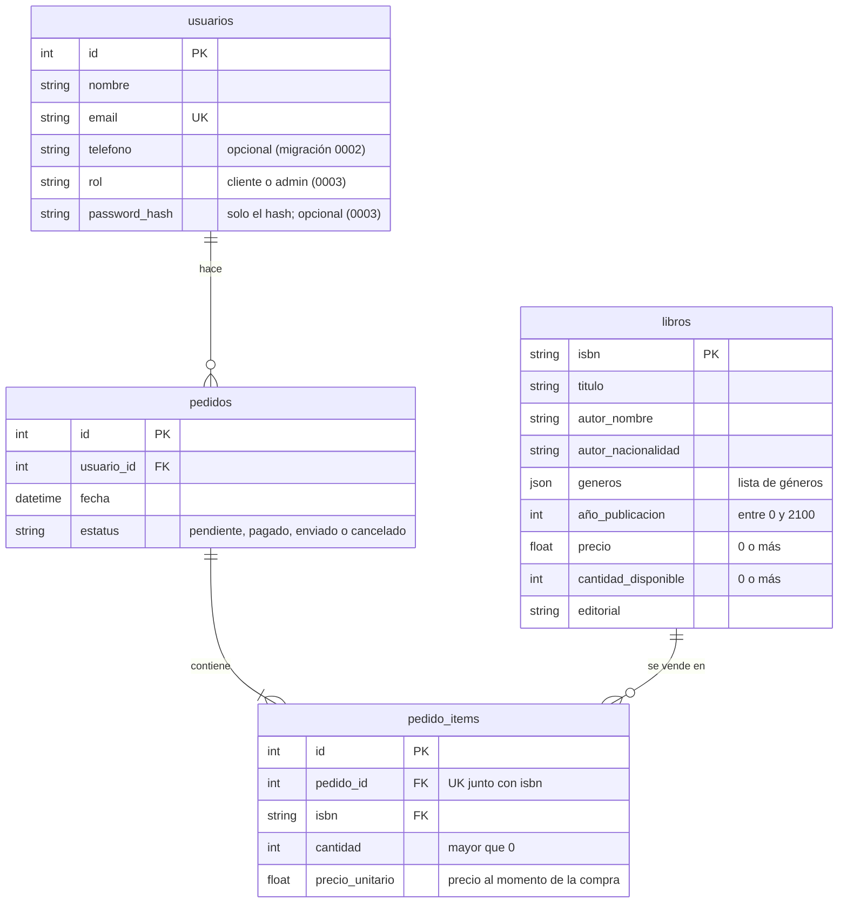
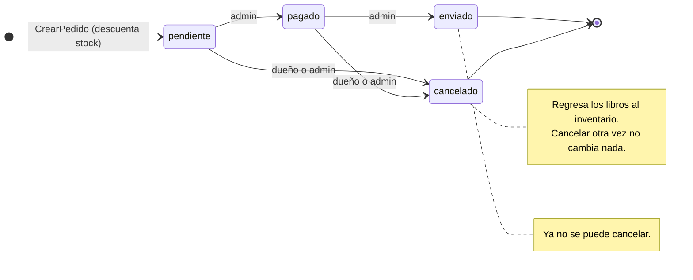

# Detalles técnicos

Cómo funciona el proyecto por dentro. Para instalarlo y usarlo, ve al [README](../README.md); para saber qué cambió y cuándo, al [historial de cambios](../CHANGELOG.md).

## Contenido

1. [Arquitectura: capas, puertos y adaptadores](#1-arquitectura-capas-puertos-y-adaptadores)
2. [Base de datos y migraciones](#2-base-de-datos-y-migraciones)
3. [API web por dentro](#3-api-web-por-dentro)
4. [Consola: captura, portadas y guardado](#4-consola-captura-portadas-y-guardado)
5. [Modelo de best sellers](#5-modelo-de-best-sellers)
6. [Docker, integración continua y auditoría](#6-docker-integración-continua-y-auditoría)
7. [Pruebas](#7-pruebas)

## 1. Arquitectura: capas, puertos y adaptadores

| Capa | Carpeta | Puede importar | Contenido |
|---|---|---|---|
| Dominio | `dominio/` | Solo el dominio (y pydantic) | `Libro` (con su inventario), `Autor`, `Usuario`, `Pedido`, estatus y transiciones, filtros del catálogo, excepciones |
| Aplicación | `aplicacion/` | Dominio | Puertos (`puertos.py`), casos de uso (`casos_uso/`) y `ServicioCatalogo` (`servicios.py`) |
| Infraestructura | `infraestructura/` | Dominio y aplicación | Adaptadores: SQLAlchemy, JSON/CSV, Open Library, notificaciones, Argon2, logging, utilidades |
| Presentación | `api/`, `consola/`, `analitica/` | Todas las anteriores | FastAPI, menú de consola y herramientas por lotes de ML |

**Puertos** (`aplicacion/puertos.py`): describen *qué* necesita la aplicación, no *cómo* se hace. Son `Protocol`: un adaptador los cumple con tener los mismos métodos, sin heredar (tipado estructural, que mypy verifica).

| Puerto | Para qué | Adaptadores |
|---|---|---|
| `UnidadDeTrabajo` (con `libros`, `pedidos`, `usuarios` y `ventas`) | Leer y guardar en la base, todo junto o nada | `UnidadDeTrabajoSQL`, `UnidadDeTrabajoEnMemoria` |
| `Notificador` | Avisar al cliente de su pedido | `NotificadorHTTP`, `NotificadorRegistro` (log), `NotificadorEnMemoria` |
| `Hasher` | Hashear y verificar contraseñas | `HasherArgon2` |
| `RepositorioCatalogo` | Cargar y guardar el catálogo de la consola | `CatalogoJSON`, `CatalogoEnMemoria` |
| `LectorLibros` | Leer libros de un archivo externo | `LectorCSV` |

**Unidad de trabajo**: los repositorios nunca hacen commit. `with uow: ... uow.confirmar()` guarda todos los cambios juntos; si no se confirma o hay una excepción, al salir del `with` se revierte todo. Así, descontar stock y registrar el pedido ocurren juntos o no ocurren.

**Casos de uso** (`aplicacion/casos_uso/`, un módulo por recurso). Todos se construyen con sus puertos y se usan con `ejecutar()`:

| Recurso | Escritura | Consulta |
|---|---|---|
| Libros | `AgregarLibro`, `ActualizarLibro`, `EliminarLibro` (solo si nunca se vendió) | `ObtenerLibro`, `ListarLibros` (con filtros) |
| Usuarios | `RegistrarUsuario`, `ActualizarUsuario`, `CambiarRol` (un admin no se quita el suyo), `CambiarPassword`, `EliminarUsuario` (solo sin pedidos), `AsegurarAdministrador` | `Autenticar`, `ObtenerUsuario`, `BuscarUsuarioPorEmail`, `ListarUsuarios` |
| Pedidos | `CrearPedido`, `CambiarEstatusPedido` (también cancela) | `ObtenerPedido`, `ListarPedidos`, `PedidosDeUsuario` |
| Reportes | — | `GastoPorUsuario`, `LibrosMasVendidos` |

Cada caso de uso **orquesta, no decide**: obtiene los datos por los puertos, deja las decisiones al dominio (`crear_pedido()`, `Libro.retirar()`, …), confirma, y solo entonces avisa al cliente. El aviso va fuera de la transacción: nunca se avisa de algo que se revirtió, y si el aviso falla, el pedido ya quedó guardado (solo se registra una advertencia). La fecha del pedido sale de un reloj inyectado, así las pruebas pueden fijarla.

**Raíz de composición**: el único lugar que conoce los adaptadores concretos y arma los casos de uso con ellos. En la API es `api/dependencies.py`; en la consola, `consola/main.py`.

**`tests/test_arquitectura.py`** revisa con `ast` (sin ejecutar el código) los `import` de todos los módulos. Falla si una capa importa una de arriba, si el dominio o la aplicación importan una biblioteca técnica (SQLAlchemy, FastAPI, httpx, pwdlib, jwt, scikit-learn, pandas) o si un router importa la infraestructura.

## 2. Base de datos y migraciones

### Modelo de datos

Cada usuario hace cero o más pedidos; cada pedido contiene una o más líneas (`pedido_items`), y cada línea es un libro con su cantidad.



- Cada línea de pedido guarda el **precio al momento de la compra**: si después cambia el precio del catálogo, el total del pedido no cambia.
- `infraestructura/basedatos.py` solo tiene lo técnico: las tablas (clases `*DB`), el motor, las funciones que traducen filas ↔ objetos del dominio e `importar_catalogo()`. Las lecturas y escrituras las hacen los repositorios de `repositorios_sql.py`.
- En SQLite las llaves foráneas vienen apagadas; `crear_motor()` las enciende en cada conexión.

### Estados de un pedido

Las transiciones permitidas están en `TRANSICIONES` (`dominio/pedidos.py`); cualquier otra lanza `TransicionEstatusError` (409 en la API). Quién puede hacer cada cambio lo revisa la API.



Cancelar no borra el pedido: cambia su estatus y regresa los libros al inventario.

### Migraciones

Están en `migraciones/versions/`:

| Revisión | Qué hace |
|---|---|
| `0001_esquema_inicial` | Crea `libros`, `usuarios`, `pedidos` y `pedido_items` con llaves foráneas, restricciones `CHECK`/`UNIQUE` e índices |
| `0002_telefono_usuario` | Agrega `usuarios.telefono` |
| `0003_autenticacion` | Agrega `usuarios.rol` y `usuarios.password_hash` |

- **Batch mode** (`render_as_batch=True` en `env.py`): SQLite casi no soporta `ALTER TABLE`, así que Alembic crea una tabla nueva, copia los datos y reemplaza la vieja.
- **Nombres fijos para las restricciones** (`CONVENCION_NOMBRES` en `basedatos.py`): sin ellos, Alembic no podría modificarlas ni borrarlas después.
- **`LIBRERIA_URL_BD`**: `env.py` la lee igual que la API, para que nunca apunten a bases distintas.
- **Pruebas**: `env.py` acepta una conexión externa; así `test_migraciones.py` migra una base en memoria sin tocar la real.

| Comando | Qué hace |
|---|---|
| `alembic current` | Versión actual de la base |
| `alembic history` | Lista de migraciones |
| `alembic downgrade -1` | Revierte la última migración |
| `alembic check` | Verifica que los modelos y las migraciones coincidan |
| `alembic upgrade head --sql` | Muestra el SQL sin conectarse a la base |

## 3. API web por dentro

| Archivo | Qué hace |
|---|---|
| `routers/` | Un `APIRouter` por recurso (`auth`, `libros`, `usuarios`, `pedidos`, `reportes`). Cada endpoint solo traduce HTTP ↔ caso de uso: arma el comando, llama a `ejecutar()` y devuelve el resultado. |
| `dependencies.py` | La raíz de composición: elige `UnidadDeTrabajoSQL`, `NotificadorHTTP`/`NotificadorRegistro` y `HasherArgon2`, y arma cada caso de uso (`ListarLibrosDep`, `CrearPedidoDep`, …). También abre una sesión de base por petición (con `yield`), busca el libro, usuario o pedido de la URL, arma la paginación y revisa la autenticación. |
| `seguridad.py` | Crea y lee los tokens JWT (PyJWT). No depende de FastAPI. |
| `schemas.py` | Esquemas pydantic de entrada (`Create`/`Update`) y salida (`Read`), con sus validaciones: formato de ISBN, año no futuro, géneros sin repetir, email en minúsculas, teléfono, al menos un campo en los `PATCH`, sin ISBN repetidos en un pedido, y contraseñas de 8 a 128 caracteres con letras y números. |
| `app.py` | Crea la app, incluye los routers y traduce las excepciones del dominio y de los casos de uso a códigos HTTP (404 no existe, 409 conflicto, 422 datos inválidos, 400 el resto). |
| `crear_admin.py` | Crea el primer administrador, o da rol de admin y contraseña nueva a una cuenta existente (caso de uso `AsegurarAdministrador`). |

**Permisos**: `usuario_actual` lee el token (401 si falta o no sirve), `requiere_admin` exige rol de admin (403), y `usuario_autorizado` y `pedido_autorizado` permiten solo al propio usuario o a un admin. Se aplican en tres niveles: como parámetro del endpoint, en el decorador (`dependencies=[...]`, en libros) o en todo un router (pedidos y reportes). Sin token se responde 401 **antes** que 404, para no revelar qué ids existen.

**Tokens y contraseñas**:
- El token solo guarda el id del usuario y su caducidad. El rol se lee de la base en cada petición, así que un cambio de rol surte efecto sin volver a iniciar sesión.
- Las contraseñas se guardan como hash Argon2 (`infraestructura/passwords.py`), nunca en texto plano. El hash va aparte del objeto `Usuario`, para que nunca termine en una respuesta por accidente.
- Al iniciar sesión, la contraseña se verifica **siempre**, con un hash falso si el email no existe, y el mensaje de error es el mismo en ambos casos. Así no se puede averiguar qué emails están registrados.

## 4. Consola: captura, portadas y guardado

**Agregar un libro (opción 3)**:

```
ISBN: 9780307474728
  🔎 Buscando el ISBN en Open Library...
  ✅ Encontrado: Cien años de soledad — Gabriel García Márquez
     Presiona Enter para aceptar el valor entre [corchetes] o escribe otro.
Título [Cien años de soledad]:
Nombre del autor [Gabriel García Márquez]:
Nacionalidad del autor: Colombiana
```

Las búsquedas se recuerdan 10 minutos (`@cache_temporal`, `SEGUNDOS_CACHE_ISBN`): repetir un ISBN, con o sin guiones, no vuelve a usar la red. Los errores no se guardan en la caché.

**Portadas faltantes (opción 5)**:

```
🖼️  Descargando 12 portada(s) (5 a la vez)... puede tardar un poco.

✅ 9 portada(s) descargada(s) en: data/portadas
ℹ️  2 libro(s) sin portada en Open Library:
   - 978-607-16-0001-1
   - 978-607-16-0002-8
⚠️  1 portada(s) no se pudieron descargar:
   - 978-0-14-044913-6: No se pudo descargar la portada: ...
```

Cómo funciona (`descargar_portadas()` en `infraestructura/buscador.py`):

- Cada ISBN es una corrutina con dos peticiones: la edición en `openlibrary.org` (para obtener el id de la portada) y la imagen en `covers.openlibrary.org`, por *streaming*.
- La imagen se escribe primero en un archivo `.part` y solo se renombra si la descarga terminó; así un corte de conexión no deja archivos a medias.
- Todas las corrutinas comparten un `httpx.AsyncClient` por servidor, así que reutilizan las conexiones.
- Un `asyncio.Semaphore` deja pasar como máximo `MAX_DESCARGAS_SIMULTANEAS` (5) a la vez, para no saturar a Open Library.
- Se ejecutan con `asyncio.gather(..., return_exceptions=True)`: si un ISBN falla, los demás siguen y el error queda en el resumen (un `TaskGroup` cancelaría todo al primer error).
- Los errores de red pasajeros se reintentan con `@reintentar_async`, que espera con `await asyncio.sleep()` para no congelar el *event loop*.
- El menú es síncrono, así que lo ejecuta con `asyncio.run()`.

**Guardado seguro del catálogo**: se escribe en un archivo temporal y solo reemplaza al original si todo salió bien (`escritura_atomica`). Si el guardado falla, `ServicioCatalogo` deshace también los cambios en memoria, para que memoria y disco coincidan.

## 5. Modelo de best sellers

- **Etiqueta** (`etiquetar()`): un libro es best seller si está en el 20 % superior de unidades vendidas, sin contar pedidos cancelados. Un libro sin ventas nunca lo es.
- **Características**: precio, año, géneros, editorial y nacionalidad del autor, es decir, solo datos conocidos *antes* de vender. `cantidad_disponible` no se usa, porque baja justamente cuando el libro se vende (sería fuga de datos).
- **Pipeline** (`construir_modelo()`): un `ColumnTransformer` convierte los géneros en una columna 0/1 por género (`CountVectorizer`, sin distinguir mayúsculas), y la editorial y la nacionalidad con `OneHotEncoder(handle_unknown="ignore")`. Después, un `RandomForestClassifier` con `class_weight="balanced"`, porque hay unos 4 libros "no" por cada "sí".
- **Evaluación** (`entrenar()`): separa el 25 % de los libros para prueba con `stratify`, reporta precision, recall, F1 y ROC AUC, y compara la exactitud contra decir siempre "no es best seller". Después vuelve a entrenar con todos los libros, y ese es el modelo que se guarda.
- **Guardado** con joblib. ⚠️ joblib usa pickle: carga solo modelos que tú mismo entrenaste.
- **Datos sintéticos**: la tendencia está escrita a mano en `datos_sinteticos.popularidad()` (thrillers, fantasía y novelas baratas se venden más; poesía y ensayo, menos). `importancias()` muestra qué rasgos usó el modelo, para compararlos con esa regla.

| Programa | Opciones (valor por defecto) |
|---|---|
| `libreria.analitica.datos_sinteticos` | `--bd` (`data/sintetico.db`), `--libros` (300), `--usuarios` (100), `--pedidos` (3000), `--semilla` (42), `--reemplazar` |
| `libreria.analitica.prediccion entrenar` | `--bd` (`data/sintetico.db`), `--modelo`, `--percentil` (0.8), `--semilla` (42) |
| `libreria.analitica.prediccion predecir` | `--bd` (`data/libreria.db`), `--modelo` |

## 6. Docker, integración continua y auditoría

**Dockerfile multistage**:

| Etapa | Qué hace | ¿Llega a la imagen final? |
|---|---|---|
| `builder` | Instala Poetry 2.5.1 (la versión que generó `poetry.lock`) y las dependencias de producción (`--only main`, sin el extra `ml`) en `/opt/venv`, y empaqueta el proyecto como *wheel* | No |
| `runtime` | Copia solo `/opt/venv`, `alembic.ini` y `migraciones/`, y corre con el usuario `libreria` (no root) | Sí |

- La imagen final no lleva Poetry, herramientas de desarrollo, pruebas, código fuente suelto ni bibliotecas de ML: unos 88 MB de bibliotecas en lugar de 347 MB.
- Primero se copian solo `pyproject.toml` y `poetry.lock`: mientras no cambien, Docker reutiliza la capa de dependencias (la más lenta) aunque cambie el código.
- Al arrancar ejecuta `alembic upgrade head` y después `exec uvicorn`. El `exec` hace que uvicorn reciba directamente las señales de `docker stop` y se apague limpio.
- `HEALTHCHECK` consulta `/docs` cada 30 segundos.
- `.dockerignore` deja fuera `data/`, `logs/`, `.env`, `.git`, las pruebas y los respaldos, para que ningún dato ni secreto termine dentro de la imagen.

**GitHub Actions** (`.github/workflows/ci.yml`): corre en cada push a `master`/`main`, en cada pull request y a mano (botón **Run workflow**).

| Trabajo | Qué hace | Depende de |
|---|---|---|
| Lint, formato y tipos | `ruff check`, `ruff format --check` y `mypy` (con `--all-extras`, para revisar también `prediccion.py`) | — |
| Pruebas | `pytest` con cobertura; `coverage.xml` queda como artefacto descargable | — |
| Imagen Docker | Construye la imagen, la levanta y comprueba que `/docs` responde, que `/libros/` devuelve `[]` en una base nueva y que `/reportes/usuarios` sin token da 401 | Los dos anteriores |

A diferencia de pre-commit, que corre en tu máquina y se puede saltar (`git commit --no-verify`), el CI corre siempre en GitHub e incluye las pruebas. Si un push nuevo llega a la misma rama, se cancela la ejecución anterior.

**Auditoría de dependencias** (`.github/workflows/auditoria.yml`):

- **Cuándo corre**: en cada push y pull request, cada lunes a las 7:17 (hora de la Ciudad de México) y a mano. La ejecución semanal detecta vulnerabilidades publicadas después del último cambio de código.
- **Qué revisa**: instala todo (`--all-extras`: producción, extra `ml` y desarrollo) y ejecuta `pip-audit --skip-editable`, que consulta la base de avisos de seguridad de PyPI para la versión exacta de cada paquete. `--skip-editable` omite el propio proyecto, que no está en PyPI.
- **Evidencia**: si hay vulnerabilidades, el trabajo falla (código de salida 1) y muestra cada una con su identificador (por ejemplo `PYSEC-2018-28`) y la versión que la corrige. Siempre se guarda `auditoria-dependencias.json` como artefacto durante 90 días, con la lista de paquetes auditados y sus vulnerabilidades.
- **GitHub pausa los workflows programados** en repositorios públicos sin actividad durante 60 días. Si pasa, se reactiva desde la pestaña **Actions**.

**Dependabot** (`.github/dependabot.yml`), cada lunes a las 7:00:

| Qué vigila | Cómo propone los cambios |
|---|---|
| Dependencias de Python (`pyproject.toml` + `poetry.lock`) | Las actualizaciones menores y de parche, juntas en un pull request; las mayores, una por una. Máximo 5 abiertos a la vez |
| Acciones de los workflows (`actions/checkout`, `actions/setup-python`, …) | Un pull request por acción |

Cada pull request de Dependabot pasa por el CI y por la auditoría antes de aceptarlo. La imagen base de Docker no se vigila: su etiqueta sigue a Python 3.13 (`python:3.13-slim`), y GitHub la descarga actualizada en cada construcción.

Las **alertas de Dependabot** son un ajuste del repositorio, no un archivo: se activan en **Settings → Code security** y avisan en cuanto se publica una vulnerabilidad que afecte a `poetry.lock`.

## 7. Pruebas

Son 297 funciones de prueba que se ejecutan como **393 pruebas**. La diferencia viene de dos técnicas de pytest:

- **`@pytest.mark.parametrize`**: una función corre con varios datos; por ejemplo, 6 contraseñas débiles distintas.
- **Fixtures parametrizadas**: cada prueba de contrato corre una vez por adaptador (`[sql]` y `[memoria]`, etc.).

| Archivo | Tipo | Qué revisa |
|---|---|---|
| `test_pedidos.py` | Unitaria | Reglas de pedidos e inventario sobre objetos del dominio, sin base de datos |
| `test_filtros.py` | Unitaria | Estrategias de filtrado del catálogo |
| `test_cache.py` | Unitaria | `@cache_temporal`, con un reloj falso para no esperar de verdad |
| `test_casos_uso.py` | Unitaria | Orquestación de pedidos y avisos con `UnidadDeTrabajoEnMemoria` |
| `test_casos_uso_libros_usuarios.py` | Unitaria | Casos de uso de libros, usuarios, autenticación y reportes, con un `HasherFalso` (Argon2 es lento a propósito) |
| `test_servicios.py` | Unitaria | `ServicioCatalogo`: guarda una vez y revierte si el guardado falla |
| `test_buscador.py` | Unitaria | Open Library simulado con `httpx.MockTransport` (sin internet) y su caché |
| `test_portadas_concurrentes.py` | Unitaria | Descarga en lote con `asyncio`; simula una red lenta para comprobar que el semáforo nunca deja pasar de más |
| `test_notificador_http.py` | Unitaria | Petición, errores y reintentos del notificador HTTP |
| `test_arquitectura.py` | Unitaria | Dirección de las dependencias entre capas |
| `test_contrato_repositorios.py` | Contrato | La misma batería con `[sql]` y `[memoria]`: repositorios, reportes y unidad de trabajo |
| `test_contrato_catalogo.py` | Contrato | `[json]` y `[memoria]` |
| `test_contrato_notificador.py` | Contrato | `[http]`, `[registro]` y `[memoria]` |
| `test_crud.py` | Integración | Los casos de uso contra SQLite en memoria, incluidos los rollbacks |
| `test_basedatos.py` | Integración | Pedidos, precio histórico y reportes con la base real (en memoria) |
| `test_migraciones.py` | Integración | `upgrade`/`downgrade` de Alembic y que coincidan con los modelos (como `alembic check`) |
| `test_datos_sinteticos.py` | Integración | Generador reproducible y protección de la base real |
| `test_prediccion.py` | Integración | Etiqueta, entrenamiento (una sola vez por archivo, `scope="module"`), predicción y guardado del modelo |
| `test_api.py` | API | Endpoints, inicio de sesión, tokens y permisos con `TestClient`; la sesión de base se reemplaza con `app.dependency_overrides` |

**Por qué hay pruebas de contrato**: las unitarias usan adaptadores en memoria porque son rápidos. El contrato garantiza que esos adaptadores se comportan igual que los reales. Si la versión en memoria "mintiera", el contrato fallaría.

`conftest.py` da a cada prueba una base SQLite en memoria nueva con el catálogo de `tests/datos/catalogo_prueba.json` (fijo, para no depender de `data/libreria.json`), limpia la caché de ISBN antes de cada prueba y ofrece atajos que usan los casos de uso reales.
